# ComplaintIQ deployment and portfolio guide

This guide describes the repository as it exists locally. ComplaintIQ is a prototype for evaluation and
local demonstration; it has not been hardened or certified for production, regulatory, or legal use.

## Requirements and installation

Python 3.10 or later is declared in `pyproject.toml`; the current local validation runtime is Python 3.12.
Install from the repository root:

```powershell
python -m venv .venv
.\.venv\Scripts\Activate.ps1
python -m pip install --upgrade pip
python -m pip install -e ".[dev,data,serve]"
pytest -q
ruff check .
```

On macOS/Linux, use `python3 -m venv .venv` and `source .venv/bin/activate`. Optional extras:

| Extra | Purpose |
|---|---|
| `dev` | pytest, Ruff, and Locust |
| `data` | DuckDB and PyArrow for CFPB ingestion and Parquet |
| `serve` | FastAPI, Uvicorn, Pydantic, and Streamlit |
| `embed` | Sentence Transformers for non-hashing embeddings and cross-encoder reranking |
| `faiss` | Optional FAISS HNSW quantization comparison |

The smallest offline demo does not need CFPB files or downloaded models:

```powershell
python -m complaintiq demo
```

It generates synthetic data and builds artifacts under `artifacts/demo`. Synthetic results must not be
reported as real-data model performance.

## Configuration and model setup

Settings are read from the process environment. Copy `.env.example` to `.env` for reference, but load those
values using your shell or a secret manager: Python and Docker Compose do not automatically source every
`.env` file as shell environment. Never commit `.env` or paste a real key into examples/issues.

| Variable | Default | Description |
|---|---|---|
| `CIQ_DATA_DIR` | `data` | Local input/data directory |
| `CIQ_ARTIFACTS_DIR` | `artifacts` | Artifact bundle location |
| `CIQ_RESULTS_DIR` | `results` | Evaluation output directory |
| `CIQ_DOCS_DIR` | `docs` | Generated markdown output directory |
| `CIQ_EMBEDDER` | `hashing` | `hashing` for offline demo; otherwise a Sentence Transformers model name/alias |
| `CIQ_RERANKER` | `lexical` | `lexical`, `none`, or cross-encoder model name |
| `CIQ_LLM` | `mock` | `mock`, `ollama`, or `gemini` |
| `CIQ_OLLAMA_URL` | `http://localhost:11434` | Ollama server URL |
| `CIQ_OLLAMA_MODEL` | `qwen2.5:7b` | Ollama model; pull it separately with `ollama pull qwen2.5:7b` |
| `CIQ_GEMINI_MODEL` | `gemini-flash-latest` | Gemini model name; confirm current availability with Google |
| `GEMINI_API_KEY` | empty | Gemini credential; required only for `CIQ_LLM=gemini` |
| `CIQ_API_KEY` | empty | If set, API operations require `X-API-Key`; empty disables API authentication |
| `CIQ_RATE_LIMIT` | `60` | Per-client requests/minute |
| `CIQ_LLM_THRESHOLD` | `0.70` | Classifier confidence below which triage asks the configured LLM |
| `CIQ_MIN_DENSE_SCORE` | `0.20` | Draft similarity floor; weaker evidence is refused |
| `CIQ_MAX_CHARS` | `2000` | Maximum text length processed by internal sanitization |
| `CIQ_PRICE_IN_PER_M` | `0.75` | Configured input price per million tokens, for estimates only |
| `CIQ_PRICE_OUT_PER_M` | `3.75` | Configured output price per million tokens, for estimates only |

`hashing` is a deterministic n-gram hashing vectorizer, not a semantic embedding model. Selecting an actual
Sentence Transformers embedder or a cross-encoder requires `.[embed]` and may download model weights on
first use. `bge-small` maps to `BAAI/bge-small-en-v1.5`; `minilm` maps to
`sentence-transformers/all-MiniLM-L6-v2`. The current evidence-template drafting path does not call an LLM;
the LLM setting is relevant to low-confidence classification and other configured LLM tasks.

### Artifact compatibility

Build artifacts before starting the API:

```powershell
python -m complaintiq build --src data\processed --sample 100000 --since 2024 --embedder hashing
```

The artifact directory must contain `manifest.json`, `vectors.npy`, `meta.joblib`, `clf.joblib`, and
`bm25.joblib`. `CIQ_ARTIFACTS_DIR` must point to the directory containing those files, not its parent.
Treat `joblib` artifacts as trusted executable inputs: do not load bundles from untrusted sources, and
restrict who can write to the artifact directory.

The project writes Python/scikit-learn version information into manifests for new builds. Scikit-learn
does not promise cross-version compatibility for pickled estimators. Build and load with the same exact
scikit-learn version whenever possible; a version warning means compatibility is not guaranteed. The
current local benchmark runtime is scikit-learn 1.9.0. The previously recorded API validation saw an
artifact estimator reporting 1.9.1, so that bundle/runtime pair is not a clean deployment baseline.
Rebuild artifacts using the intended pinned runtime before deployment, and keep the runtime version with
the bundle. `pyproject.toml` currently specifies a lower bound rather than an artifact-specific lockfile.

## CFPB data provenance, privacy, and restrictions

The source is the [CFPB Consumer Complaint Database](https://www.consumerfinance.gov/data-research/consumer-complaints/).
The live bulk file is available from the CFPB; the repository's download command uses
`https://files.consumerfinance.gov/ccdb/complaints.csv.zip`. Consult the CFPB database's own
[data, methodology, and disclaimer information](https://www.consumerfinance.gov/data-research/consumer-complaints/)
for current publication rules and interpretation. A complaint is a consumer submission, not an independently
verified finding; the public database is not a random sample of all consumer experiences.

**Source-format caveat:** the local ingestion code records that, since August 14, 2026, the live bulk file
no longer contains complaint narratives. To build a narrative corpus, obtain the applicable CFPB FOIA
Consumer Complaint Database Narratives Archive separately and pass its archive/file/folder path with
`--narratives`. Validate archive provenance and current CFPB terms before use. `ingest` can also retain
complaints without narratives with `--keep-blank`, but narrative-based classification/retrieval needs text.

For example, download the bulk file, obtain any applicable narratives archive separately, then ingest/build:

```powershell
python -m complaintiq download --out data\raw
python -m complaintiq ingest --src data\raw\complaints.csv.zip --out data\processed `
  --since 2020 --narratives C:\private-data\narratives.zip
python -m complaintiq build --src data\processed --out artifacts `
  --sample 100000 --since 2020 --embedder hashing
```

The archive path above is a placeholder for a locally obtained file; it is not included in this repository.
Check the ingest statistics for narrative coverage before building. The sample and `--since` options are
dataset selections, not promises that the resulting corpus has that many usable, unique narratives.

Ingestion applies a regex-based PII redaction layer and deduplication; API inputs are sanitized and access
logs omit request bodies. These are safeguards, **not a guarantee that identifying or sensitive details
are removed**. Review data before sharing or sending it to an external model. Complaint narratives can
contain sensitive details and untrusted instructions. Do not commit raw CFPB files, extracted archives,
narratives, derived complaint-level exports, credentials, or audit databases. CFPB publication does not
make every use, redistribution, or external transfer appropriate; follow applicable CFPB terms, privacy
requirements, organizational policy, and law.

Raw input/processed files, artifacts, `.env`, and SQLite databases are ignored by Git. The local working
tree also contains a large archive at `docs/complaints.csv.zip`; it is intentionally excluded by the
repository ignore rule and must not be added to a commit.

## Architecture and processing workflow

```mermaid
flowchart LR
    CFPB[CFPB bulk data and optional narratives archive] --> INGEST[Ingest, redact, deduplicate, Parquet]
    INGEST --> BUILD[Chronological split and artifact build]
    BUILD --> ART[Manifest, vectors, classifier, BM25, metadata]
    ART --> API[FastAPI request validation and rate limit]
    API --> TRIAGE[Sanitize and injection check]
    TRIAGE --> CLF[Classifier and confidence]
    CLF -->|low confidence, no injection| LLM[Configured classifier LLM]
    CLF --> RISK[Rule-based risk flags and team routing]
    LLM --> RISK
    API --> RETRIEVE[Training-index BM25/dense/RRF retrieval]
    RETRIEVE --> DRAFT[Evidence-only response template and citations]
    RISK --> AUDIT[Audit decisions and review queue]
    DRAFT --> AUDIT
    AUDIT --> HUMAN[Human approve/reject]
    HUMAN --> SEND[Approval-gated send record]
    API --> OBS[Structured logs and metrics]
```



1. `download` fetches the CFPB bulk archive; `ingest` normalizes fields, redacts patterns, deduplicates,
   optionally joins the narratives archive, and writes year/month Parquet partitions.
2. `build` sorts records chronologically, removes normalized narrative templates, makes a temporal split,
   computes embeddings, fits the product classifier on the earlier rows, builds BM25, and saves an artifact
   bundle. Embeddings are stored alongside the metadata.
3. `/triage` validates and sanitizes text, runs the classifier, conditionally uses the configured LLM below
   the confidence threshold unless injection is suspected, computes rule-based risk flags/team routing, and
   logs the decision.
4. `/draft` searches the saved corpus and produces a deterministic evidence-template draft citing retrieved
   complaint IDs. Insufficient evidence is refused. Historical response categories are context, not a
   guarantee of correctness or legal approval.
5. Drafts enter the review queue. Only approved decisions can be marked sent. Audit records store request
   IDs, timestamps, model/artifact versions where available, hashed input, decisions and evidence IDs.
6. API access logs omit request bodies. `/metrics` exposes operational metrics; it is currently public.

## Run and use the API

Start from the repository root after installing `.[serve]` and building/mounting artifacts:

```powershell
$env:CIQ_ARTIFACTS_DIR = "artifacts"
$env:CIQ_API_KEY = "local-development-key"
python -m complaintiq serve --host 127.0.0.1 --port 8000
```

For a local test request, use only synthetic text:

```powershell
curl.exe -H "X-API-Key: local-development-key" `
  -H "Content-Type: application/json" `
  -d '{"text":"Synthetic test message for API request."}' `
  http://127.0.0.1:8000/triage
```

For drafting, use the same synthetic-only body:

```powershell
curl.exe -H "X-API-Key: local-development-key" `
  -H "Content-Type: application/json" `
  -d '{"text":"Synthetic test message for API request."}' `
  http://127.0.0.1:8000/draft
```

Examples below show response shapes; generated labels, scores, IDs, citations, and text vary by artifact.
Do not treat example values as evaluation results.

| Method and path | Purpose | Authentication |
|---|---|---|
| `GET /health` | Liveness only; returns `{"status":"ok"}` without checking artifact readiness | None |
| `POST /triage` | Classification, routing, risk flags, review state | `X-API-Key` if configured |
| `POST /draft` | Evidence-grounded draft/refusal and cited precedent metadata | `X-API-Key` if configured |
| `GET /queue` | Pending review items | `X-API-Key` if configured |
| `POST /queue/{queue_id}/approve` | Approve a pending item | `X-API-Key` if configured |
| `POST /queue/{queue_id}/reject` | Reject a pending item | `X-API-Key` if configured |
| `POST /decisions/{decision_id}/send` | Record send only after approval | `X-API-Key` if configured |
| `GET /metrics` | Prometheus-style HTTP and service metrics | **Public; no authentication today** |
| `GET /docs` | Interactive OpenAPI docs | None |

All text endpoints accept JSON `{"text":"..."}`. Text must be 10–20,000 characters and non-blank.
Example triage response:

```json
{
  "product": "example product label",
  "confidence": 0.81,
  "source": "classifier",
  "team": "General Review",
  "risk_flags": [],
  "needs_review": false,
  "review_reasons": [],
  "est_cost_usd": 0.0,
  "decision_id": 1
}
```

Example draft response shape:

```json
{
  "status": "refused",
  "text": "NOT_ENOUGH_PRECEDENT: insufficient retrieved evidence to prepare a response.",
  "citations": [],
  "precedents": [],
  "reasons": ["insufficient retrieval similarity"],
  "decision_id": 2,
  "queue_id": 1
}
```

For an `ok` draft, approve its returned queue item with
`POST /queue/{queue_id}/approve` and
`{"reviewer":"local reviewer","note":"Reviewed synthetic example."}`. Only then call
`POST /decisions/{decision_id}/send` with an empty body. The refused example is not a draft to send.
Real use requires a connected, separately authorized delivery integration; the current endpoint records
the approval-gated action. Successful approve/reject requests return `{"ok":true}` and a successful send
returns `{"sent":true}`. Invalid input returns 422;
unavailable artifacts produce 503 on model-dependent operations. Responses include `X-Request-ID`.

## Docker

The current Dockerfile installs `data,serve` extras and runs the same CLI/UI. With Docker Desktop:

```powershell
docker compose config
docker compose up --build
```

On first start, an empty named `artifacts` volume causes the entrypoint to build a synthetic demo artifact.
The named volume persists between starts. This is intentionally convenient for local demos, not a real-data
deployment workflow. To use an already-built real artifact, place the five required bundle files in a trusted
host directory and mount that directory at `/app/artifacts` when running the image; the service needs write
access there for its audit database. Do not copy private or raw complaint data into the image:

```powershell
docker build -t complaintiq:local .
docker run --rm -p 8000:8000 `
  -e CIQ_APP=api -e CIQ_API_KEY=local-development-key `
  -v "C:\path\to\trusted-artifact:/app/artifacts" `
  complaintiq:local
```

The artifact directory must be writable because the audit SQLite database is created alongside the bundle.
Keep that directory trusted and persistent. Set model/provider environment variables as appropriate. For
Sentence Transformers in the image, set `CIQ_DOCKER_EXTRAS=data,serve,embed` before rebuilding. For
host-installed Ollama from inside a container, set `CIQ_OLLAMA_URL=http://host.docker.internal:11434`.
Compose exposes the UI directly; the UI has no authentication. Do not expose either service publicly in
this configuration.

## Evaluation results and interpretation

The local reports describe a deterministic sample of 100,000 CFPB narrative rows; after template deduplication,
67,452 remain (53,961 train, 13,491 chronological test). They do not represent the full CFPB database. The
report files under `results/` should be regenerated when the data, artifact, dependencies, or hardware change.

| Evaluation | Result | Interpretation and limitation |
|---|---|---|
| Classifier | Macro-F1 0.4564; support-weighted F1 0.6462; accuracy 0.6161 vs. majority 0.3624; ECE 0.055 | Entire saved temporal test split, product labels, `hashing` embedder. At confidence ≥0.7, 48.5% are auto-handled at 0.7936 accuracy. This is a sampled CFPB benchmark, not external validation. See `results/classifier_metrics.md`. |
| Retrieval | 300 later queries. Hit@5: BM25 0.697, dense 0.510, RRF 0.667. RRF MRR@10 0.500; nDCG@10 0.315. | Relevance means matching product **and** issue (proxy labels), not human relevance or useful precedent. Boundary and template overlap were filtered. `hashing` is lexical, not semantic. See `results/retrieval_evaluation.md`. |
| Risk | 5,576/13,491 holdout complaints flagged (41.3%). | Coverage counts only. There are no human labels, so precision, recall, and meaningful priority ranking are unmeasured. See `results/risk_coverage.md`. |
| Spikes | 139 alerts across 124 weeks of data; 2,004,605 source rows counted. | Historical chronological alert output; severity is a statistical magnitude bucket. No incident labels: false-alert rate, predictive accuracy, and detection latency are unknown. See `results/spike_evaluation.md`. |
| Drafting | 100 later complaints: 99 successful drafts, 1 refusal; automated citation/template checks passed; 0 model generation calls. | Structural grounding checks only. No human-rated quality, semantic entailment study, or legal suitability assessment. See `results/evidence_generation.md`. |
| Performance | Local 1k/2.5k/5k workloads; at 5k, retrieval p50/p95/p99 ms: BM25 1.968/10.482/12.040, dense 7.380/17.701/19.509, RRF 6.710/27.792/42.595, lexical rerank 24.595/96.777/110.965. | One 4-logical-CPU Windows laptop, 7.88 GiB RAM. API used TestClient and MockLLM; observed process peak working set 1,224 MB. Not a production load test or capacity estimate. See `results/performance_evaluation.md`. |

Measured external spend was $0 because no provider was called. The performance report's $0.1605/1,000
escalated triages is an assumption-based price-list estimate (94 input and 24 output tokens at configured
prices), not observed spend. The ingestion timing in that report measures bounded reads from processed
Parquet and includes source scan overhead; it is not raw ingestion throughput. Quantized recall is top-10
overlap against exact float32, not human retrieval quality; on this sample int8 had 0.936 overlap at 5k
but was slower than float32, and binary variants had poor overlap. No quantization change is recommended
by these observations.

Re-run evaluations against the selected local artifact/source (these commands overwrite their corresponding
report files):

```powershell
python -m complaintiq eval-classifier
python -m complaintiq eval-retrieval --n-queries 300 --seed 0
python -m complaintiq risk-audit
python -m complaintiq eval-spikes --src data\processed
python -m complaintiq eval-drafts --n-queries 100 --seed 0
python -m complaintiq benchmark --src data\processed --sizes 1000 2500 5000 `
  --ingest-sizes 100 500 --n-queries 50 --api-requests 10 --concurrency 1 2
```

The spike backtest scans the processed source; retrieval, classifier, risk, and draft evaluations use the
saved temporal artifact split. Performance uses MockLLM and local TestClient, and no evaluator establishes
human-judged quality.

## Known limitations and deployment blockers

- **Artifacts and scikit-learn:** pickle/joblib estimator compatibility is not guaranteed across versions.
  The local runtime is 1.9.0; the prior API validation reported a 1.9.1 estimator warning. Rebuild under an
  explicitly pinned environment before deployment.
- **Public metrics:** `GET /metrics` does not use the API-key guard. Do not expose it on an untrusted network.
- **Health is not readiness:** `GET /health` always reports liveness and does not check whether artifacts,
  the LLM, Parquet source, or database is ready.
- **No human-labeled risk/retrieval ground truth:** risk numbers are rule coverage; retrieval metrics use
  product+issue proxy relevance. Neither establishes real-world accuracy.
- **Dataset and privacy:** public complaints can include sensitive details. Regex masking is not guaranteed
  anonymization; external model calls require privacy/legal approval.
- **No production hardening validation:** no TLS/reverse proxy, secret-rotation design, backup/recovery,
  distributed rate limiting, deployment threat model, provider SLA, or regulatory certification is provided.
- **No reproducible lockfile:** dependency ranges are declared in `pyproject.toml`, not a fully locked build.
  Re-run the suite and compare exact runtime/model versions for each deployment image.
- **User interface:** the demo Streamlit UI accesses the service directly and is unauthenticated.
- **No claim of legal adequacy:** responses are evidence-template drafts, not legal advice or approved company
  responses; a human reviewer remains responsible.

## Verification run

On October 30, 2026, the documented editable install (`python -m pip install -e ".[dev,data,serve]"`)
completed successfully on Python 3.12. `python -m complaintiq demo` was run with a fresh temporary
artifact directory and produced a synthetic artifact; the documented Uvicorn command was then started
against it, and `/health` plus an API-key-protected synthetic `/triage` request both returned HTTP 200.
The full suite reported **66 passed**; `ruff check .` passed; `docker compose config` passed.

The test run emitted three warnings: one Starlette/httpx TestClient deprecation and two scikit-learn
unpickle version warnings (artifact 1.9.1 vs runtime 1.9.0). Docker CLI was installed, but the Docker
Engine was unavailable (`dockerDesktopLinuxEngine` pipe absent), so image build and container startup
could not be verified in this environment.

## Project structure

```text
src/complaintiq/
  api/app.py            FastAPI endpoints, validation, access logs, metrics
  cli.py                build, ingest, evaluation, benchmark, serve commands
  classify.py           classifier and temporal split helpers
  data.py, ingest.py    normalized data loading and CFPB ingestion
  embed.py, retrieve.py embeddings, BM25/dense/RRF and reranking
  risk.py, spikes.py    rule flags and weekly spike detection
  draft.py, service.py  cited template drafts, workflow and orchestration
  audit.py              SQLite decisions, review queue and approval gate
  pipeline.py           artifact build and load
  evals/                retrieval, draft, risk, spike and performance evaluators
  ui/streamlit_app.py   local demonstration UI
tests/                  unit, CLI, API and integration tests
data/, artifacts/       local data and trained artifacts; ignored by Git
results/                generated evaluation reports
docs/                   portfolio/deployment guide and generated markdown
Dockerfile              Linux API/UI image
docker-compose.yml       local API and Streamlit services
```
