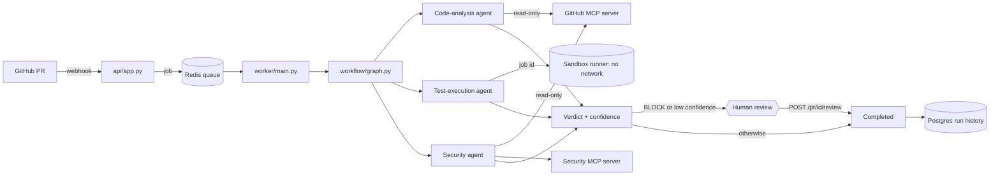

# MergeGuard

MergeGuard reviews GitHub pull requests with three specialised agents (code analysis, test execution, dependency security), combines their findings into a verdict (`MERGE`, `MERGE_WITH_COMMENTS`, `BLOCK`), and pauses for a human decision when the verdict is risky or uncertain.

Untrusted pull-request code never runs in the API or worker. Tests run in a separate container with no network, and each agent can only call the tools it needs.

## How a review flows



1. **Intake.** `POST /webhook/github` (signed by GitHub) or `POST /webhook/pr` (API key) validates the request and puts a job on a Redis queue. It answers `202` immediately. ([`api/app.py`](src/mergeguard/api/app.py))
2. **Worker.** Takes the job, fetches the PR, diff, comments and source archive from GitHub, and stages the source for the sandbox. ([`worker/main.py`](src/mergeguard/worker/main.py))
3. **Workflow.** A LangGraph graph runs the three agents in parallel, then the orchestrator applies the verdict rules. ([`workflow/graph.py`](src/mergeguard/workflow/graph.py))
4. **Agents.** Each agent calls tools only through MCP servers, restricted by an allowlist. ([`agents/`](src/mergeguard/agents/), [`mcp_servers/`](src/mergeguard/mcp_servers/))
5. **Human review.** If the verdict is `BLOCK` or confidence is below `0.6`, the graph pauses. A reviewer sends `POST /pr/{job_id}/review` with a decision and reason; the worker resumes the graph. ([`workflow/graph.py`](src/mergeguard/workflow/graph.py), [`api/app.py`](src/mergeguard/api/app.py))
6. **Record.** Verdict, findings, reasons, tool events and overrides are stored in Postgres and feed `GET /metrics`. ([`storage/db.py`](src/mergeguard/storage/db.py))

## Where to start reading the code

Read in this order; each step is one folder or file.

| # | Path | What it is |
|---|---|---|
| 1 | `src/mergeguard/api/app.py` | HTTP endpoints, auth, webhook signature check, job enqueue |
| 2 | `src/mergeguard/worker/main.py` | Queue consumer, retries, dead letters, resume |
| 3 | `src/mergeguard/workflow/graph.py` | The LangGraph workflow, verdict rules, human-review pause |
| 4 | `src/mergeguard/agents/` | The three agents plus shared state models and the MCP client |
| 5 | `src/mergeguard/mcp_servers/` and `tools/` | The tools agents may call (GitHub reads, sandbox client, dependency scanner) |
| 6 | `src/mergeguard/sandbox/` | Sandbox job protocol and the runner that executes tests |
| 7 | `src/mergeguard/guardrails/`, `storage/`, `observability/`, `evaluation/` | Prompt-injection checks, database, tracing and metrics, golden-set scoring |

## Repository layout

```
.
├── src/mergeguard/            Application package (installed as `mergeguard`)
│   ├── api/                   FastAPI app
│   ├── worker/                Queue worker (python -m mergeguard.worker)
│   ├── workflow/              LangGraph graph and verdict rules
│   ├── agents/                Code-analysis, test-execution, security agents
│   ├── mcp_servers/           GitHub, test-runner and security MCP servers
│   ├── tools/                 GitHub client, dependency scanner, sandbox client
│   ├── sandbox/               Sandbox job protocol and runner service
│   ├── guardrails/            Prompt-injection detection
│   ├── storage/               Postgres access
│   ├── observability/         Tracing (Langfuse) and operational metrics
│   └── evaluation/            Golden-set scoring
├── tests/                     Mirrors src/: workflow, agents, api, sandbox, ...
├── scripts/                   Command-line tools (golden-set evaluation)
├── eval/                      Golden PR set and evaluation results
├── docs/                      Architecture, decisions (ADRs), MCP notes, portfolio drafts
├── .github/                   CI workflow and Copilot instructions
├── docker-compose.yml         api, worker, sandbox runner, redis, postgres (+ optional Langfuse)
├── Dockerfile                 Application image
├── pyproject.toml             Package and pytest configuration
├── requirements.txt           Direct dependencies
└── requirements.lock          Pinned dependencies used by the image and CI
```

## Run it with Docker

```powershell
Copy-Item .env.example .env      # then fill in the values (see Configuration)
docker compose up --build -d
Invoke-RestMethod http://localhost:8000/health
```

Submit a PR for review:

```powershell
Invoke-RestMethod -Method Post http://localhost:8000/webhook/pr `
  -Headers @{ "X-API-Key" = "<MERGEGUARD_WEBHOOK_API_KEY>" } `
  -ContentType "application/json" `
  -Body '{"owner":"your-user","repo":"your-repo","pr_number":1}'
```

Then poll `GET /pr/{job_id}/status`. If the status becomes `awaiting_review`, send a decision:

```powershell
Invoke-RestMethod -Method Post http://localhost:8000/pr/<job_id>/review `
  -Headers @{ "X-API-Key" = "<MERGEGUARD_WEBHOOK_API_KEY>" } `
  -ContentType "application/json" `
  -Body '{"decision":"MERGE","reason":"verified manually"}'
```

## Develop locally

```powershell
python -m venv .venv
.venv\Scripts\Activate.ps1
pip install -r requirements.lock
pip install --no-deps -e .
python -m pytest
```

Tests use fakes for Redis, GitHub, Gemini and the sandbox, so they run without Docker or API keys. The `tests/` folders mirror `src/mergeguard/`.

## Configuration

Set these in `.env` (template: `.env.example`).

| Variable | Used by | Purpose |
|---|---|---|
| `GITHUB_TOKEN` | worker | Read PRs, files, comments and source archives |
| `GITHUB_WEBHOOK_SECRET` | api | Verifies `X-Hub-Signature-256` on `/webhook/github` |
| `MERGEGUARD_WEBHOOK_API_KEY` | api | `X-API-Key` for `/webhook/pr` and `/pr/{id}/review` |
| `GEMINI_API_KEY`, `GEMINI_MODEL` | worker | Code-analysis and vulnerability triage |
| `MERGEGUARD_DB_PASSWORD` | postgres | Database password (`DATABASE_URL` is derived) |
| `LANGFUSE_PUBLIC_KEY`, `LANGFUSE_SECRET_KEY`, `LANGFUSE_HOST` | api, worker | Optional tracing; no-op when unset |

## API

| Endpoint | Auth | Purpose |
|---|---|---|
| `GET /health` | none | Redis reachability |
| `POST /webhook/github` | GitHub HMAC signature | Real GitHub `pull_request` events (opened, synchronize, reopened) |
| `POST /webhook/pr` | `X-API-Key` | Manual submission: `{owner, repo, pr_number}` |
| `GET /pr/{job_id}/status` | none today | Job status, result, pending review payload |
| `POST /pr/{job_id}/review` | `X-API-Key` | Submit `{decision, reason}` for a paused job |
| `GET /metrics` | none today | Tool success rate, completion rate, override rate, skipped-agent share |

Job states: `queued` → `running` → `completed` or `awaiting_review` → `review_queued` → `resuming` → `completed`; `failed` after three attempts.

## Tool privileges

| Agent | May call | Cannot |
|---|---|---|
| Code analysis | GitHub reads only | Run tests, scan dependencies |
| Test execution | `run_tests(job_id)` only | Pass a command or path |
| Security | GitHub reads, `scan_dependencies` | Run tests |
| Orchestrator | Combines structured results | Call tools |

Allowlists live in [`agents/mcp_client.py`](src/mergeguard/agents/mcp_client.py); the import rules are enforced by [`tests/architecture/test_privilege_boundaries.py`](tests/architecture/test_privilege_boundaries.py).

## Status

- Test suite: **110 passed** (`python -m pytest`).
- Measured results are not available yet. Fill these only from `eval/results/*.json` and a live `/metrics` response:

| Measurement | Value | Source |
|---|---|---|
| Golden PR accuracy | [X] | `eval/results/*.json` |
| Golden PR precision / recall by verdict | [X] | `eval/results/*.json` |
| Tool success rate | [X] | `/metrics` |
| Task completion rate | [X] | `/metrics` |
| Human override rate | [X] | `/metrics` |

- Not deployed to Cloud Run; Docker Compose is the supported way to run it.
- Known gaps and the ordered backlog are in [`docs/open-work.md`](docs/open-work.md).

## Documentation

See [`docs/README.md`](docs/README.md): architecture, decision records, MCP notes, the prompt-injection test procedure, and portfolio drafts.
