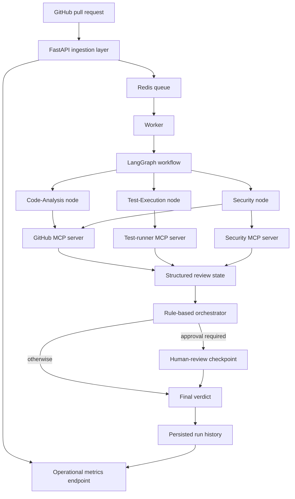

# MergeGuard architecture

This document describes the implemented local workflow. It does not assert a production deployment or a measured evaluation outcome.

## System shape

## Intake and job execution

The FastAPI application accepts PR submissions and supported GitHub pull-request webhook events. It authenticates requests, deduplicates active jobs by repository/head, and pushes job payloads to Redis. A worker consumes jobs, fetches PR metadata and source data from GitHub, stages the source workspace, invokes the LangGraph workflow, then persists the result. Job state is available through the status endpoint.

**Implementation and tests:** [`api/app.py`](../src/mergeguard/api/app.py), [`worker/main.py`](../src/mergeguard/worker/main.py), [`test_webhook_and_queue.py`](../tests/api/test_webhook_and_queue.py), and [`test_worker_sandbox_flow.py`](../tests/integration/test_worker_sandbox_flow.py).

## Agents and MCP tool boundaries

The MCP servers use the official Python SDK and run over stdio. Agents connect using the SDK client session. Tool allowlists are checked before a server process is started or a tool is called.

| Agent / component | Allowed tools or action | Limit |
|---|---|---|
| Code-Analysis | GitHub `get_pull_request`, `get_changed_files`, `get_file_content`, `get_pr_conversation` | No test-runner or security tools; it cannot request arbitrary command execution. |
| Test-Execution | `test_runner.run_tests(job_id)` | One job identifier; fixed test invocation delegated to the sandbox. |
| Security | GitHub read tools and `security.scan_dependencies` | Dependency scanning accepts manifest names/content; it does not have the test-runner tool. |
| Orchestrator | Combines structured state and applies verdict rules | Does not invoke the sandbox directly. |

**Implementation and tests:** [`agents/mcp_client.py`](../src/mergeguard/agents/mcp_client.py), [`mcp_servers/`](../src/mergeguard/mcp_servers/), [`test_protocol_and_allowlists.py`](../tests/mcp/test_protocol_and_allowlists.py), and [`docs/mcp.md`](mcp.md).

The Security agent fetches supported dependency manifests through the GitHub MCP server and sends them to the Security MCP server. The scanner uses pip-audit for Python requirements and npm audit for supported npm manifests; vulnerability triage may use the configured Gemini service.

**Implementation and tests:** [`agents/security.py`](../src/mergeguard/agents/security.py), [`tools/dependency_scanner.py`](../src/mergeguard/tools/dependency_scanner.py), and [`test_security_agent.py`](../tests/agents/test_security_agent.py).

## Test execution and sandbox behavior

The test-runner MCP tool accepts a job ID and delegates to the sandbox job mechanism. The Compose configuration gives the sandbox runner no network, mounts staged workspaces read-only, and applies process and memory limits. Its test command is fixed; no MCP tool accepts an arbitrary shell command.

If imports or dependencies are missing in the no-network sandbox, the result is an inability-to-run status, not an automatic block. The graph retains a reason, lowers confidence, and requests human review.

**Implementation and tests:** [`tools/sandbox_client.py`](../src/mergeguard/tools/sandbox_client.py), [`sandbox/jobs.py`](../src/mergeguard/sandbox/jobs.py), [`docker-compose.yml`](../docker-compose.yml), [`test_sandbox_client.py`](../tests/tools/test_sandbox_client.py), and [`test_result_classification.py`](../tests/sandbox/test_result_classification.py).

## Verdict and human review

The orchestrator combines code findings, test results, security findings, and prompt-injection flags into `MERGE`, `MERGE_WITH_COMMENTS`, or `BLOCK`. A `BLOCK` verdict or confidence below the configured threshold requests human review. The graph pauses at its checkpoint; the authenticated review endpoint validates the decision, queues a resume action, and the worker resumes the graph. A queued review response is distinct from a completed resumed job.

**Implementation and tests:** [`workflow/graph.py`](../src/mergeguard/workflow/graph.py), [`api/app.py`](../src/mergeguard/api/app.py), [`worker/main.py`](../src/mergeguard/worker/main.py), [`test_human_review_resume.py`](../tests/integration/test_human_review_resume.py), and [`test_human_approval_policy.py`](../tests/workflow/test_human_approval_policy.py).

## Persistence and metrics

The database layer stores completed run outcomes, tool events, and human-review decisions. The `/metrics` endpoint derives tool success rate, task completion rate, human override rate, skipped-agent percentage, job counts by status, and total runs from stored data. These metrics are operational indicators, not golden-set model accuracy.

**Implementation and tests:** [`storage/db.py`](../src/mergeguard/storage/db.py), [`observability/metrics.py`](../src/mergeguard/observability/metrics.py), [`api/app.py`](../src/mergeguard/api/app.py), [`test_metrics_endpoint.py`](../tests/api/test_metrics_endpoint.py), and [`test_operational_metrics.py`](../tests/observability/test_operational_metrics.py).

## Evaluation status

The golden PR runner computes accuracy, per-class precision/recall, and a confusion matrix from human-supplied expected verdicts. [`eval/golden_prs.json`](../eval/golden_prs.json) is empty until real PRs are reviewed and labeled. No evaluation accuracy is claimed without a generated report under `eval/results/`. See [`eval/README.md`](../eval/README.md) and the README's measured-results table.

## Deployment boundary

The repository contains a Docker Compose configuration for local services. MergeGuard is not deployed to Cloud Run. A passing Compose configuration check or a local test run does not establish that a production deployment is running.

## Further reading

- Design decisions: [`decisions.md`](decisions.md)
- MCP protocol and servers: [`mcp.md`](mcp.md)
- Local startup and measured-results placeholders: [`README.md`](../README.md)
